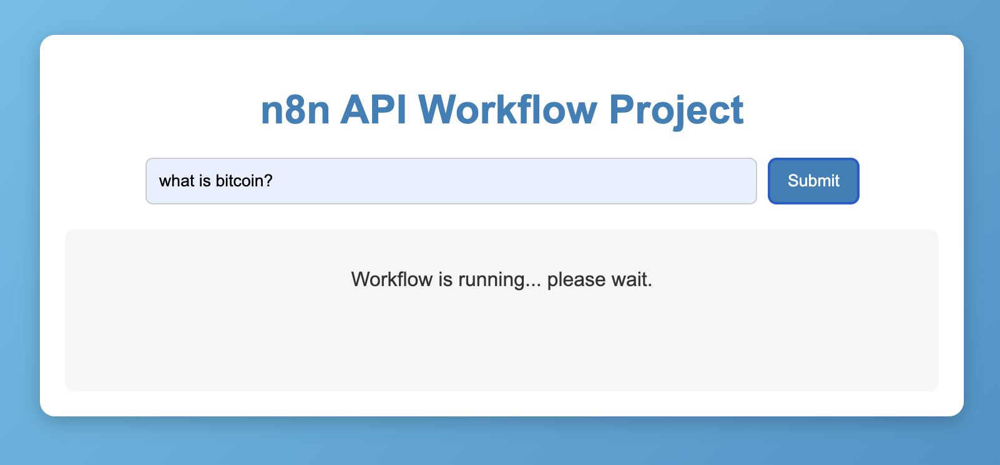
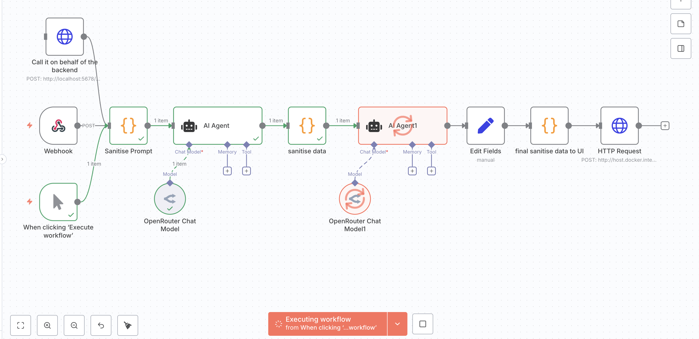

# n8n AI Webhook Demo

Type a question in a web page → it is sent to an **n8n workflow** → the workflow asks an AI model → the answer shows up on the page.



**Who does what**

- **n8n** does the real work: builds the prompt, calls the AI model (via [OpenRouter](https://openrouter.ai)), formats the answer.
- **This Node.js app** is only a thin bridge: it serves the page, validates the question, calls the n8n webhook, and passes n8n's answer back to the browser.

## How it works

```
Browser ──1. POST /inputPrompt──▶ Node app ──2. POST /webhook/prompt──▶ n8n (AI runs here)
   ▲                                 ▲                                      │
   │ 4. answer pushed live (SSE)     └────── 3. POST /getResponse ◀─────────┘
   └─────────────────────────────────┘
```

1. The browser sends your question to the app. The app checks it and forwards it to n8n.
2. n8n runs the workflow (this can take a while, so the app does not wait).
3. When finished, n8n sends the answer to the app's `/getResponse` endpoint.
4. The app pushes the answer to the page, which shows it as a table.

The workflow in n8n looks like this (older screenshot; the extra test node on the top-left no longer exists):



## Prerequisites

- [Node.js](https://nodejs.org) 18 or newer
- [Docker](https://www.docker.com/products/docker-desktop/) (used to run n8n locally)
- A free [OpenRouter](https://openrouter.ai) account and API key (for the AI models)

## Quick start

### 1. Install

```bash
git clone <this-repo-url>
cd <this-repo-folder>
npm install
cp .env.example .env
```

Open `.env` and set `N8N_ENCRYPTION_KEY` (generate one with `openssl rand -base64 32`). The other values can stay as they are.

### 2. Start n8n (Docker)

```bash
docker compose up -d
```

Open <http://localhost:5678> and create your n8n owner account (first visit only).

### 3. Import and set up the workflow in n8n

1. **Workflows → ⋯ menu → Import from file** → choose `workflows/prompt-workflow.json`.
2. Open both **OpenRouter Chat Model** nodes → under *Credential*, create a new **OpenRouter** credential and paste your API key.
   - The workflow uses free models (`meta-llama/llama-4-maverick:free`, `deepseek/deepseek-r1:free`). Free models come and go; if a node fails, pick another model in that node.
3. Check the **Webhook** node: method `POST`, path `prompt`. Its *Production URL* must be `http://localhost:5678/webhook/prompt`.
4. Check the last **HTTP Request** node: URL `http://host.docker.internal:3000/getResponse`.
   (This is how n8n inside Docker reaches the app on your computer. If you run n8n without Docker, use `http://localhost:3000/getResponse`.)
5. Click **Publish** (older n8n versions: switch the **Active** toggle on). The production webhook only works while the workflow is published.

### 4. Start the app

```bash
npm start
```

Open <http://localhost:3000>, type a question, and press **Submit**.

> Everything here runs on your machine. The only thing that leaves it is your question, which n8n sends to OpenRouter.

## Configuration

All settings live in `.env` (copied from `.env.example`). There are no secrets in this repo; your OpenRouter key stays inside n8n.

| Variable | Default | What it is |
| --- | --- | --- |
| `PORT` | `3000` | Port of the Node app |
| `N8N_WEBHOOK_URL` | `http://localhost:5678/webhook/prompt` | n8n webhook the app calls |
| `N8N_ENCRYPTION_KEY` | *(you set it)* | Lets n8n encrypt your saved credentials. Keep it; changing it makes saved credentials unreadable. |
| `GENERIC_TIMEZONE` | `UTC` | Timezone used by n8n |

Handy Docker commands: `docker compose ps` (status), `docker compose logs -f` (logs), `docker compose down` (stop; your n8n data is kept).

## Example request and response

Send a question to the app:

```bash
curl -X POST http://localhost:3000/inputPrompt \
  -H "Content-Type: application/json" \
  -d '{"data": "What is bitcoin?"}'
```

Immediate response (the question was accepted by n8n):

```json
{ "success": true, "requestId": "3f1c9b0e-…" }
```

When n8n finishes, the answer is pushed to the page (you can watch it with `curl -N http://localhost:3000/events`):

```json
{ "requestId": "3f1c9b0e-…", "text": "<table>…</table>", "image": "" }
```

Error responses: `400` empty or too long question (max 500 characters), `502` n8n could not be reached.

You can also call n8n directly: `curl -X POST http://localhost:5678/webhook/prompt -H "Content-Type: application/json" -d '{"chatInput": "What is bitcoin?"}'`

## Troubleshooting

| Problem | What to do |
| --- | --- |
| Page says "Could not reach the n8n webhook" | n8n is not running (`docker compose ps`) or `N8N_WEBHOOK_URL` is wrong. |
| n8n answers 404 on `/webhook/prompt` | The workflow is not published, or the Webhook path is not `prompt`. (`/webhook-test/…` URLs only work while you click *Execute workflow*.) |
| Spinner never stops | Open **Executions** in n8n and see which node failed. Usual causes: missing OpenRouter credential, a free model that no longer exists, or the last node cannot reach `host.docker.internal:3000`. |
| `EADDRINUSE` when starting the app | Port 3000 is in use. Set a different `PORT` in `.env` (and update the URL in the HTTP Request node). |
| n8n credentials gone after changing `.env` | `N8N_ENCRYPTION_KEY` changed. Put the old value back. |

## Project files

```
index.js                         the Node app (3 endpoints + static page)
public/                          the web page (HTML, CSS, JS)
workflows/prompt-workflow.json   the n8n workflow to import
docker-compose.yml               runs n8n only
.env.example                     settings template
test/                            run with `npm test`
```

## Good to know

- This is a local demo: no login, no database. Don't expose it to the internet as is.
- The workflow does not generate images. The UI can show one if the workflow sends an image URL, but this one doesn't.
- The "bad words" list in the workflow's `sanitise data` node is a placeholder.

## License

MIT. See [LICENSE](LICENSE).
